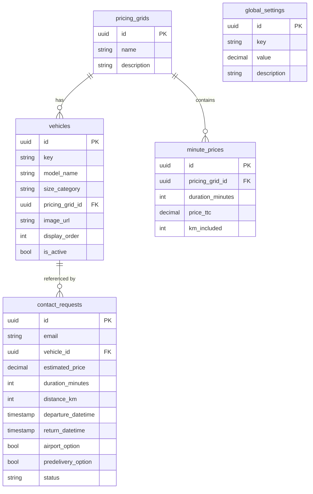

# Leo&Go Database Schema

This document describes the structure of the Supabase database tables used by the Leo&Go price simulator.

---

## Tables Overview

| Table | Description |
|-------|-------------|
| `vehicles` | Available vehicles for rental |
| `pricing_grids` | Pricing tier configurations |
| `minute_prices` | Price per duration for each grid |
| `global_settings` | Global configuration values |
| `contact_requests` | Quote requests from users |
| `admin_users` | Accounts allowed to use the admin panel |

---

## `vehicles`

Stores the available vehicles for rental.

| Column | Type | Required | Description |
|--------|------|----------|-------------|
| `id` | UUID | PK | Primary key |
| `key` | string | ✓ | Unique identifier key (e.g., "aygo", "yaris") |
| `model_name` | string | ✓ | Display name (e.g., "Toyota Aygo X") |
| `size_category` | string | ✓ | Size category (S, M, L, XL) |
| `pricing_grid_id` | UUID | ✓ | Foreign key to `pricing_grids` |
| `image_url` | string | - | Vehicle image URL |
| `display_order` | integer | - | Sort order for display |
| `is_active` | boolean | - | Whether vehicle is available |
| `created_at` | timestamp | auto | Creation timestamp |
| `updated_at` | timestamp | auto | Last update timestamp |

**Relationships:**
- `pricing_grid_id` → `pricing_grids.id`

---

## `pricing_grids`

Defines pricing tiers that vehicles can be assigned to.

| Column | Type | Required | Description |
|--------|------|----------|-------------|
| `id` | UUID | PK | Primary key |
| `name` | string | ✓ | Grid name (e.g., "Grid S - Toyota Aygo X") |
| `description` | string | - | Optional description |
| `created_at` | timestamp | auto | Creation timestamp |
| `updated_at` | timestamp | auto | Last update timestamp |

**Relationships:**
- One-to-many with `vehicles`
- One-to-many with `minute_prices`

---

## `minute_prices`

Contains price entries for each duration within a pricing grid.

| Column | Type | Required | Description |
|--------|------|----------|-------------|
| `id` | UUID | PK | Primary key |
| `pricing_grid_id` | UUID | ✓ | Foreign key to `pricing_grids` |
| `duration_minutes` | integer | ✓ | Duration in minutes |
| `price_ttc` | decimal | ✓ | Price including tax (€) |
| `km_included` | integer | ✓ | Kilometers included |
| `created_at` | timestamp | auto | Creation timestamp |

**Relationships:**
- `pricing_grid_id` → `pricing_grids.id`

**Notes:**
- Duration can range from minutes to days (1440 min = 1 day)
- CSV import format: `duration_minutes,price_ttc,km_included`

---

## `global_settings`

Stores global configuration values for the pricing system.

| Column | Type | Required | Description |
|--------|------|----------|-------------|
| `id` | UUID | PK | Primary key |
| `key` | string | ✓ | Setting identifier |
| `value` | decimal | ✓ | Setting value |
| `description` | string | - | Setting description |
| `updated_at` | timestamp | auto | Last update timestamp |

**Standard Keys:**

| Key | Unit | Description |
|-----|------|-------------|
| `unlock_fee` | € | Fee applied to each rental |
| `extra_km_rate` | €/km | Cost per km beyond included |
| `km_per_day` | km | Kilometers included per day |
| `airport_option` | € | Airport pickup/dropoff fee |
| `predelivery_option` | € | Vehicle delivery fee |

---

## `contact_requests`

Stores quote requests submitted by users.

| Column | Type | Required | Description |
|--------|------|----------|-------------|
| `id` | UUID | PK | Primary key |
| `email` | string | ✓ | User's email address |
| `vehicle_id` | UUID | - | Selected vehicle |
| `estimated_price` | decimal | - | Calculated total price (€) |
| `duration_minutes` | integer | - | Rental duration |
| `distance_km` | integer | - | Estimated distance |
| `departure_datetime` | timestamp | - | Rental start time |
| `return_datetime` | timestamp | - | Rental end time |
| `airport_option` | boolean | - | Airport option selected |
| `predelivery_option` | boolean | - | Pre-delivery option selected |
| `created_at` | timestamp | auto | Request timestamp |
| `status` | string | - | Request status (pending/processed) |

**Relationships:**
- `vehicle_id` → `vehicles.id`

---

## Access control (RLS)

Every table has Row Level Security enabled (see `supabase/migrations/`):

- **Public (anon key):** read-only access to `vehicles`, `pricing_grids`, `minute_prices` and `global_settings`. `contact_requests` accepts inserts only (`status = 'pending'`) and can never be read back.
- **Admins:** full access to every table, granted only to accounts listed in `admin_users` (checked by `private.is_admin()`). A signed-in account that is not in this table has no write access.
- Admin API routes (`PUT /api/settings`, `PATCH /api/contacts/[id]`, `PATCH|DELETE /api/vehicles/[id]`) require the user's access token (`Authorization: Bearer …`) and check `admin_users` before acting as that user.
- Prices are always computed server-side from the vehicle's own pricing grid.

**Adding an admin:** create the user in Supabase Auth (public sign-up is disabled), then run:

```sql
insert into public.admin_users (user_id)
select id from auth.users where email = 'new.admin@leoandgo.com';
```

---

## Entity Relationship Diagram



---

## Price Calculation Flow

1. User selects a **vehicle** → get `pricing_grid_id`
2. User sets **duration** → query `minute_prices` for matching duration
3. If exact duration not found → interpolate between nearest entries
4. Add **unlock_fee** from `global_settings`
5. Calculate **extra km cost** if distance > `km_included`
6. Add optional fees (**airport**, **predelivery**) from `global_settings`
7. Return total price
